> 历史版本操作教程，仅供参考。当前安装、源码位置和权限策略请以项目根 README 与 TESTING-2.0.1.md 为准。

# 🎵 HigherWeb：沉浸式在线音乐画廊

HigherWeb 用原生 HTML、CSS、JavaScript 和 Node.js 搭建。扫码连接酷狗、选择自己的歌单并检查播放资格后，可以在九卡片画廊中浏览歌曲，也可以进入黑胶唱片、三行同步歌词和全屏背景组成的沉浸模式。

这是 [Immersive-Music-Web](https://github.com/saxLov/Immersive-Music-Web) 的后续项目。**旧版读取本地 MP3/LRC、用 Live Server 打开；本版通过 Node 服务连接在线歌单，运行方法不同。**
下图是该版本的画廊模式(点击图片查看搜索快闪效果)：

[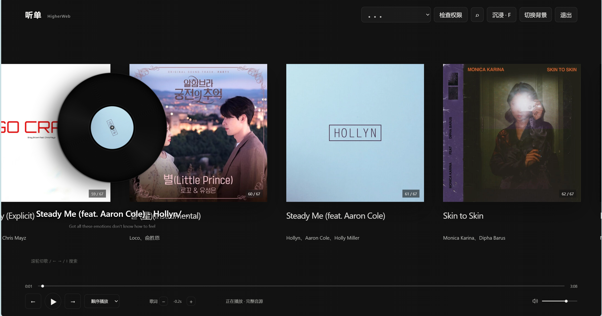](https://www.bilibili.com/video/BV1K44P6xEq8)


## 目录

1. [功能与文件](#功能与文件)
2. [第一次运行：从安装 Node.js 开始](#第一次运行从安装-nodejs-开始)
3. [操作方法](#操作方法)
4. [怎么给这份 README 插图](#怎么给这份-readme-插图)
5. [怎么改界面文字和字体](#怎么改界面文字和字体)
6. [添加自己的背景图](#添加自己的背景图)
7. [常见问题](#常见问题)
8. [测试与公开上传](#测试与公开上传)

## 功能与文件

| 功能 | 说明 |
| --- | --- |
| 九卡片画廊 | 滚轮、方向键、鼠标拖动切歌；封面未加载时有占位。 |
| 沉浸模式 | 黑胶、唱臂、实时频谱、三行同步歌词；鼠标静止约 1 秒隐藏顶部选项与光标，移动后恢复。 |
| 歌单内搜索 | 只搜索当前可播放歌单；近距离平移，远距离显示最多 18 帧且不重复的封面快闪。 |
| 播放与歌词 | 顺序、单曲循环、随机播放；歌词可每次微调 0.1 秒。 |
| 权益检查 | 不把未授权、仅试听或待确认的曲目冒充为可播放歌曲。 |
| 自定义背景 | 可给不同歌曲选择自己放入 `public/Image169/` 的背景图。 |

沉浸模式，点按f进入(再次按f退出)

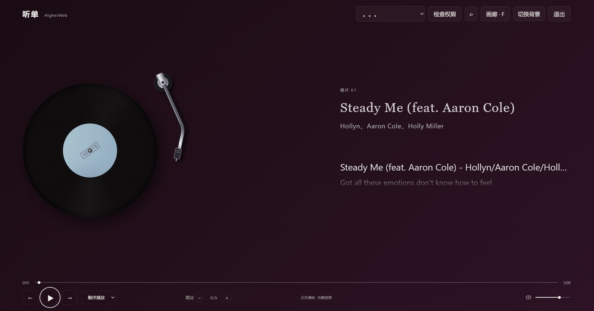

歌单内的搜索:
按i键或者直接点击右上角的搜索图标

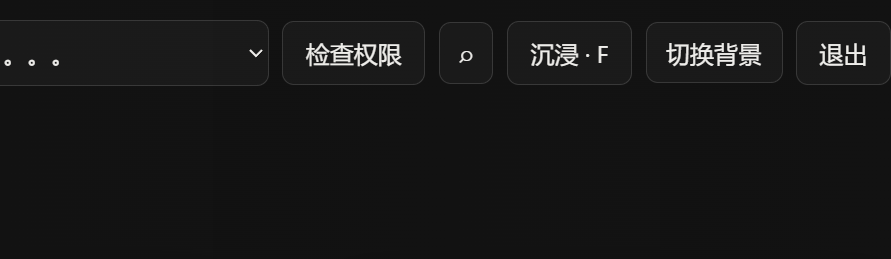


项目结构：

```text
HigerMusicWeb/
├── README.md                 本教程
├── package.json              Node 版本要求、启动和测试命令
├── server.mjs                提供网页、API 和音频的本地服务
├── scripts/setup.cmd         从 VS Code 终端运行的首次安装入口
├── scripts/setup.ps1         安装脚本，由 setup.cmd 调用
├── lib/                      登录、歌单、权益、音源等服务端模块
├── public/
│   ├── index.html            页面结构和固定文字
│   ├── style.css             画廊、歌词、沉浸模式外观
│   ├── app.js                播放、搜索、歌词和交互
│   ├── visualizer.js         实时频谱
│   ├── *.mjs                 前端媒体与队列辅助模块
│   └── Image169/             自行添加背景图；仓库默认没有个人图片
├── docs/images/              README 用的展示截图
└── test/                     自动化检查
```
如图所示:

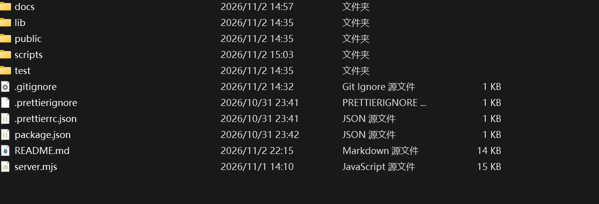

**先记住三个位置**：固定文字主要在 `public/index.html`，外观在 `public/style.css`，播放时变化的文字和操作逻辑在 `public/app.js`。页面、脚本和 API 都由 `server.mjs` 从同一个地址提供。


## 第一次运行：从安装 Node.js 开始

以下以 Windows 为例，**全程在 VS Code 内置终端操作**，终端配置为“命令提示符（Command Prompt）”。已经装好 Node.js 20 或更新版本的读者，可以从第 2 步开始。首次安装需要可访问 GitHub、npm 和酷狗服务的网络。

### 第 1 步：下载并安装 Node.js

1. 打开 [Node.js 官方下载页](https://nodejs.org/en/download)，选择适合电脑的 **LTS 长期支持版**，版本号必须为 **20 或更高**。普通 Windows x64 电脑选择对应的 Windows Installer（`.msi`）；ARM 电脑选 ARM64。版本会更新，请以官网当前页面为准。
2. 双击安装包，按向导完成安装。保留默认的 **npm** 和 **Add to PATH** 选项。安装完毕后重启 VS Code，让内置终端读取新的环境变量。
3. 如果还没有 VS Code，先从 [VS Code 官网](https://code.visualstudio.com/download) 下载 Windows 版本并安装。打开 VS Code，选择顶部菜单“终端 → 新建终端”；点终端面板右上角加号（+）旁的小箭头，选择“命令提示符（Command Prompt）”。若列表没有它，可在“选择默认配置文件”中选“命令提示符”，再新建终端。终端标签应显示“cmd”或“命令提示符”。
4. 在 **VS Code 内置终端**逐行输入：

   ```bat
   node --version
   npm --version
   ```

   第一行应显示 `v20` 或更高的大版本，第二行显示 npm 版本号。若显示“找不到 node”，先完整重启 VS Code，再检查 Node.js 安装及 PATH。

如图所示:

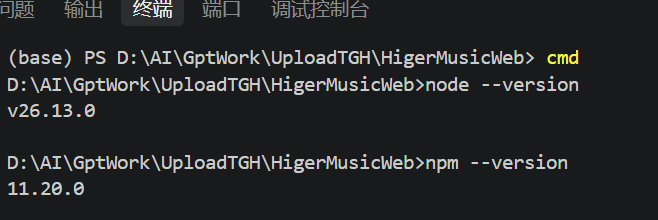

> **⚠️ Windows 用户常见报错：**
> 如果在输入 `npm --version` 时，终端爆出红字提示：**“无法加载文件 ...\npm.ps1，因为在此系统上禁止运行脚本”**。
> 这是 Windows PowerShell 的默认安全策略导致的。请点击 VS Code 终端面板右侧的 **`+` 号旁边的小箭头**，选择 **`Command Prompt` (命令提示符)**，或者以管理员身份打开 PowerShell 运行以下命令：
> `Set-ExecutionPolicy -Scope CurrentUser -ExecutionPolicy RemoteSigned`
> 输入 `Y` 确认即可解决。


### 第 2 步：下载项目，打开正确的文件夹

在 GitHub 仓库页面点 **Code → Download ZIP**，解压后找到含 `package.json` 和 `server.mjs` 的那层文件夹。打开 VS Code，选“文件 → 打开文件夹”，选择**这一层**（不要选 ZIP 外层）。左侧“资源管理器”应能看到 `README.md`、`package.json`、`public`、`scripts`。

然后选“终端 → 新建终端”，并按第 1 步选择“命令提示符”。VS Code 通常会让终端自动进入打开的文件夹。输入：

```bat
dir package.json
```

能看到 `package.json`，才表示终端当前位置正确。如果看不到，请检查 VS Code 打开的是否是解压后真正的项目根目录。
正确演示:

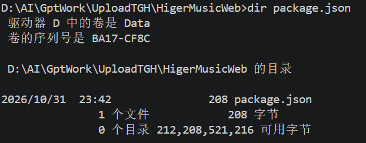


### 第 3 步：首次安装酷狗连接组件

在 **VS Code 内置终端**（命令提示符）输入：

```bat
scripts\setup.cmd
```

这个命令会调用仓库中的安装脚本，下载固定版本的酷狗连接组件并把依赖安装到项目 `.runtime/`。首次需要网络，完成后会显示 `Installed. Run: node server.mjs`。脚本只为这次安装调用设置运行权限，不永久改动系统策略；执行前可以在 VS Code 左侧打开 `scripts/setup.cmd` 和 `scripts/setup.ps1` 阅读内容。以后通常无需重复安装。

如图所示:

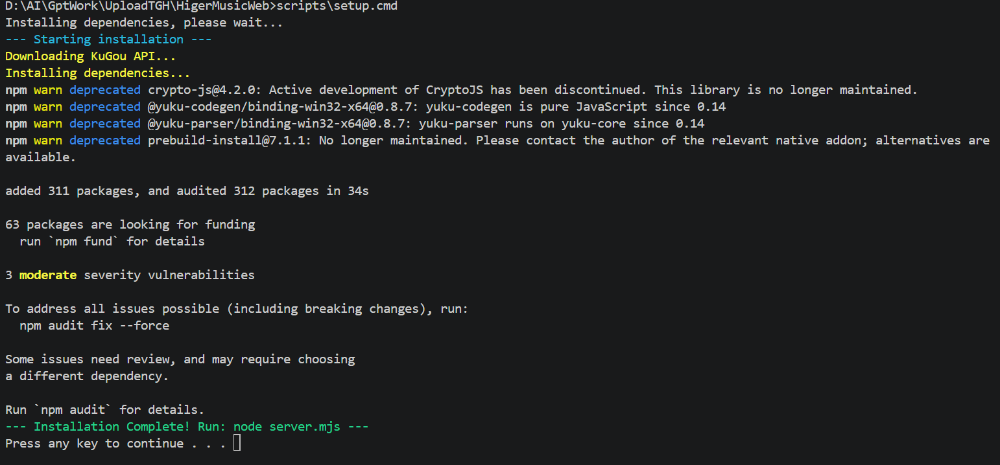


### 第 4 步：启动并打开网页

```bat
npm start
```

VS Code 终端显示 `音乐网页已启动：http://127.0.0.1:3211` 后，**保持 VS Code 和这个终端开启**，在浏览器地址栏打开 [http://127.0.0.1:3211/](http://127.0.0.1:3211/) 。也可在同一个内置终端使用 `node server.mjs`。结束服务时切回终端按 `Ctrl+C`；下次使用直接重新运行 `npm start`。
npm start的演示:

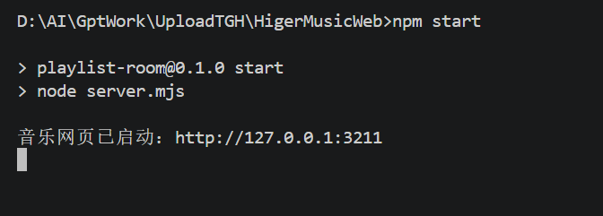

node server.mjs的演示:

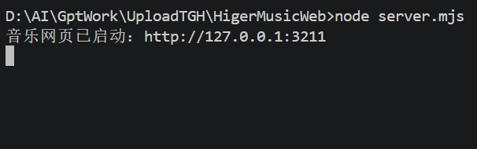

**不要双击 `public/index.html`，也不要用 Live Server 打开。**那样没有本项目的同源 API 和服务端会话，扫码和播放无法正常工作。

### 第 5 步：登录并选歌单

点击顶部“扫码登录”，用自己的酷狗账号扫码；过期可以在弹窗里刷新。登录后选择歌单，页面会逐首确认完整可用音源。歌单较长时需要等待，也可以停止后重试。已确认可播放的歌进入画廊；不满足条件（音源没有，歌曲你未购买或者要vip你没开）的歌可在“未授权的音乐”中看原因。这个虚拟歌单**不是本地 MP3 导入功能**。

选择歌单，自动进行授权:

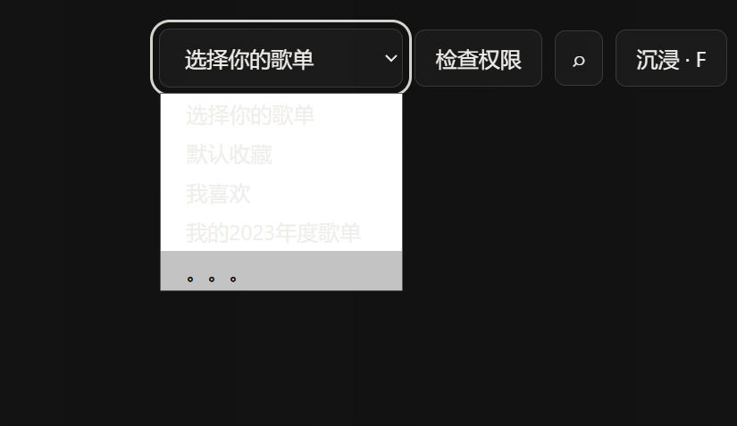

未授权的音乐会在刚刚“选择歌单”内的最上方，点击查看未授权的音乐:

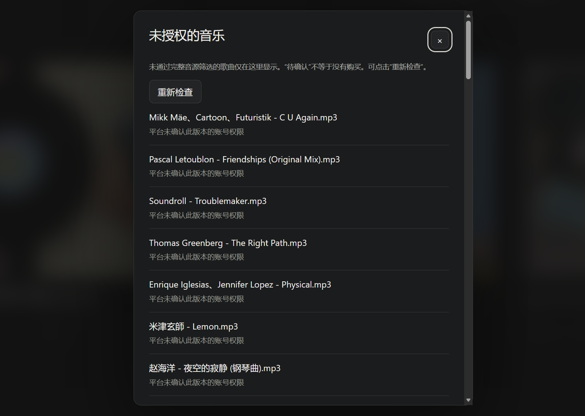


## 操作方法

| 操作 | 结果 |
| --- | --- |
| 滚轮、拖动画廊、左右方向键 | 切歌 |
| 播放按钮或空格 | 播放 / 暂停；输入框有焦点时空格照常输入 |
| “沉浸 · F”或 `F` | 切换画廊与沉浸模式 |
| 搜索按钮或 `I` | 搜索当前可播放歌单 |
| 底部播放模式下拉框 | 顺序、单曲循环、随机播放 |
| 歌词旁 `−` / `+` | 歌词延后 / 提前 0.1 秒 |
| “切换背景” | 给当前歌曲选择背景 |

# 切换背景:
把你想换的背景图放在public的image169里面
然后点击"切换背景"就会出现

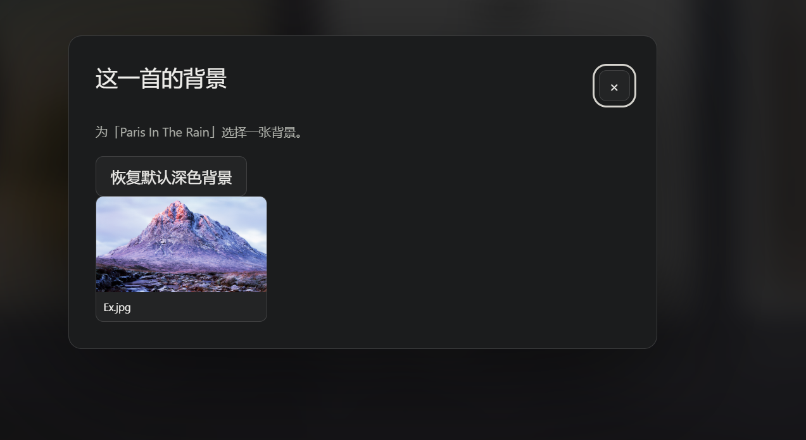

点击相应的图片即可,然后这首歌的画廊和沉浸模式就会变成

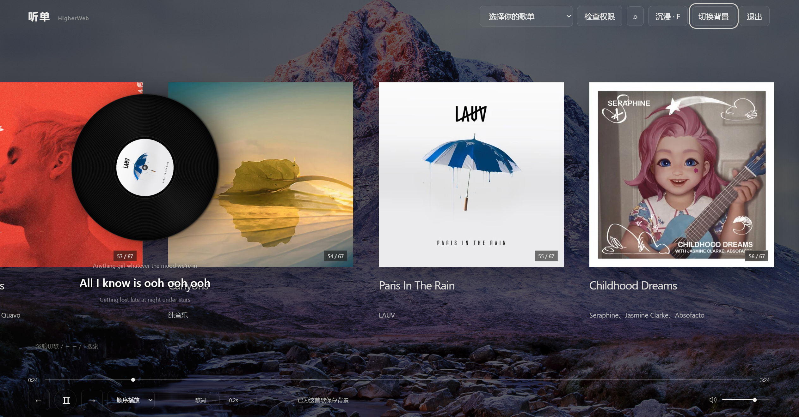

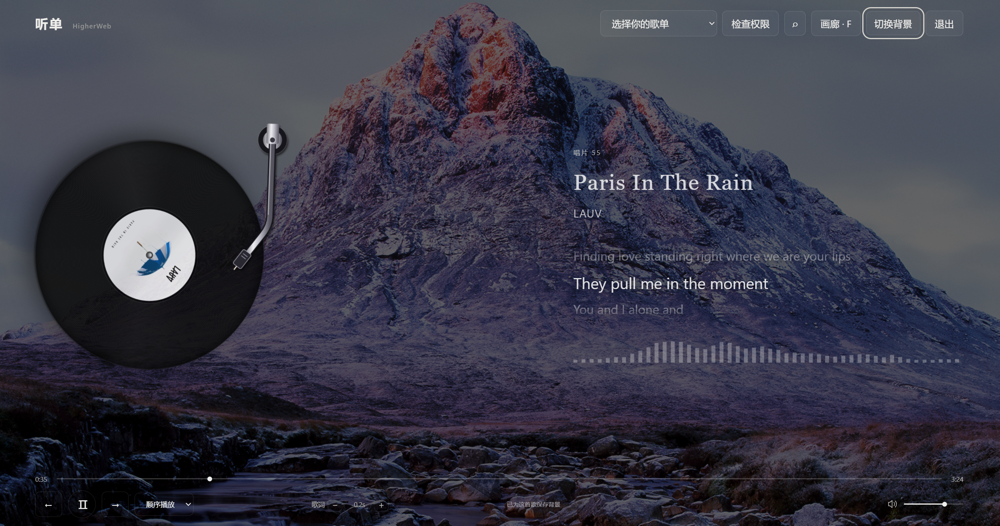


切换到其他歌时，之前的背景消失

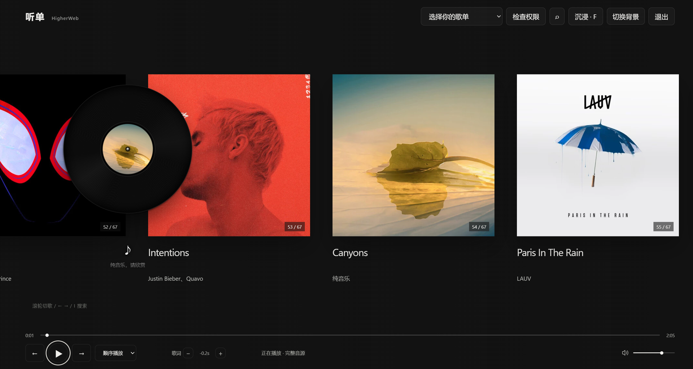


**沉浸模式下静止鼠标约 1 秒会收起顶部选项及光标，移动或按键即可恢复。切换模式不会重播当前曲。系统开启“减少动态效果”时，远距离搜索会跳过快闪。**


## 怎么改界面文字和字体

与旧版不同，本项目**没有 `siteConfig` 设置表**。先判断文字是写死在 HTML，还是由 JavaScript 随歌曲和状态产生。

### 固定文字：修改 `public/index.html`

用 VS Code 打开 `public/index.html`，按 `Ctrl+F` 搜索页面上看到的文字。顶部品牌例如：

```html
<div class="brand">听单<span>HigherWeb</span></div>
```

把 `听单` 和 `HigherWeb` 换成自己的名称。浏览器标签页标题在同一文件的 `<title>听单 / HigherWeb</title>`。顶部“扫码登录”“检查权限”“切换背景”、底部提示也在 HTML 里。改按钮文字时，可连同 `title` 和 `aria-label` 提示一起更新；**不要随意改 `id`、`class`、`script src`**，因为 CSS 和 `app.js` 要用这些标识找到元素。

### 动态文字：修改 `public/app.js`

默认歌名 `未命名歌曲`、默认歌手 `未知歌手`、状态文字 `选择一份歌单，检查可播放歌曲` 等由 `app.js` 产生。`F` 切到沉浸模式后，按钮会由 `toggleImmersive()` 改成“画廊 · F”，只改 HTML 初始按钮文字不够；要同时搜索 JS 中对应文字。歌词具体句子来自在线歌词接口，不在 HTML 中逐句填写。

### 外观：修改 `public/style.css`

| 想改的位置 | 在 CSS 中搜索 |
| --- | --- |
| 画廊歌名 / 歌手 | `.card h1` / `.card p` |
| 沉浸歌名 / 歌手 | `body.immersive #immersiveTitle` / `#immersiveArtist` |
| 高亮歌词 / 上下歌词 | `body.immersive .lyric #lyricCurrent` / `body.immersive .lyric .secondary` |
| 频谱 | `body.immersive .music-spectrum` |

CSS 中可能有多处同名选择器，**后面的规则或小屏 `@media` 规则会覆盖前面的值**。搜索时看完全部结果，确认文件后部的最终样式。不要随意删除歌词三行高度、渐隐遮罩、卡片文字区的固定高度，否则可能造成漂移或封面错位。每次改一处、保存后按 `Ctrl+F5` 刷新，并在宽屏和窄屏都查看效果。

## 添加自己的背景图

把有使用权的 `.jpg`、`.jpeg`、`.png`、`.webp` 或 `.avif` 图片复制到 `public/Image169/`，建议用横向图片和简单文件名，例如 `my-background.jpg`。保持服务运行，先选中一首歌，再点击“切换背景”挑选图片。想取消时恢复默认背景。

背景设置按歌曲 ID 保存在**当前浏览器**，不会上传到酷狗或自动同步到其他电脑。删除/改名图片会使旧选择失效。仓库 `.gitignore` 排除了 `public/Image169/` 内的个人图片；README 展示截图应放到未排除的 `docs/images/`，否则 GitHub 主页不会显示它们。

## 常见问题

### `node` 或 `npm` 找不到

按第 1 步安装 Node.js 并保留 PATH，完整重启 VS Code。在 VS Code 内置终端的“命令提示符”中运行 `node --version`、`npm --version`。

### 首次安装脚本失败

确认当前目录包含 `package.json`，网络可以访问 GitHub 和 npm。请在 VS Code 内置终端运行 `scripts\setup.cmd`；它会调用项目自带的安装脚本。下载或依赖安装中断时查看终端错误，修复网络后可重新运行脚本。

### 页面提示连接组件未安装

停止服务，在 VS Code 内置终端重新执行 `scripts\setup.cmd`；完成后再执行 `npm start`。不要直接打开 HTML。

### `127.0.0.1:3211` 无法访问

确认终端仍开着且显示启动成功。若端口占用，先到旧服务终端按 `Ctrl+C`，再重新启动。地址中的端口应与终端显示一致。

### 扫码后没有歌或某首歌不能播放

确认登录、选中歌单、完成权限检查。播放取决于账号权益、是否仅试听、平台当时的音源和网络。可在“未授权的音乐”查看原因；改变前端提示文字不会改变播放资格。


### 改了文字或 CSS 却没变化

确认改的是当前项目的 `public/` 文件，不是旧项目、备份或其他副本。保存后按 `Ctrl+F5`；CSS 还需检查文件后面的覆盖规则。
